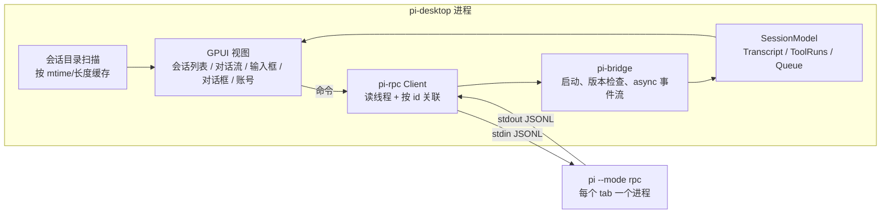

# pi-desktop 技术方案

目标：参照 omp-desktop，用 Rust 写一个 pi 的桌面客户端，界面与交互保持一致。agent 核心（模型调用、工具、会话持久化、扩展）全部由本机 `pi` 进程提供，客户端只负责界面和交互。

调研基于 pi 1.5.0（`~/.pi/agent/install/releases/1.5.0`）自带的文档 `docs/rpc.md`、`docs/rpc-commands.md`、`docs/json.md`、`docs/rpc-extension-ui.md`、`docs/session-format.md` 与 `dist/modes/rpc/rpc-mode.js`，并对本机 pi 实际抓取了事件流。

## 1. 对接方式

| 接入面 | 形式 | 结论 |
| --- | --- | --- |
| `pi --mode rpc` | stdio 上的 JSONL：命令、`response`、会话事件、扩展 UI 子协议 | **采用** |
| `pi --mode json` | 单次运行的事件流 | 只读、一次性，不够 |
| SDK（TS 嵌入） | 进程内 | 需要 Node 运行时，与 Rust 客户端不匹配 |

pi 没有官方 Rust 客户端，所以自己写 `crates/pi-rpc`（约 1k 行）：

- `wire.rs`：消息（`user` / `assistant` / `toolResult` / `bashExecution` / `custom` / 摘要）、内容块、增量事件、工具执行事件、扩展 UI 请求与回复、`get_state` / `get_session_stats` / `get_commands` 等返回值。解码宽松：未知角色、块、事件、UI 方法落到 `Other` / `Unknown`，新版 pi 不会把客户端打挂。
- `client.rs`：阻塞传输层。读线程只按 LF 切分（JSON 字符串里可能有 U+2028），按 `id` 把 `response` 交给等待的调用，其余记录作为 `Notification` 转发；进程领导独立进程组，关闭时先关 stdin（pi 的有序退出），超时再 SIGTERM → SIGKILL 整组。

与 omp 协议的差异和对应处理：

| omp-desktop 依赖 | pi 1.5 | 处理 |
| --- | --- | --- |
| `ready` 帧、协议 v2 协商 | 无握手；启动完成前不读 stdin | 第一条 `get_state` 的回复即就绪信号 |
| `set_event_filter` 开启增量 | `message_update` 本来就只带增量 | 直接重建；无 `messageId`，更新落到最新的 streaming 消息 |
| `prompt_result` / `session_settled` | `prompt` 回复带 `disposition`，结束看 `agent_settled` | `handled` 表示扩展命令消费了输入，不进入运行态 |
| `ask` 对话框、`cancel` | 只有 `select` / `confirm` / `input` / `editor`，可带 `timeout` | 有超时的对话框显示倒计时，到点本地关闭（pi 不通知） |
| 队列 remove / promote | 只有 `clear_queue` | 清空后按序重新排队；按文本从队尾匹配，期间被送达的消息不受影响；用 `prompt` + `streamingBehavior` 重排，运行恰好结束时会重新启动而不是滞留 |
| `available_commands_update` | `get_commands`（扩展命令、模板、skill） | 连接后与 `handled` 后拉取；TUI 内置命令在 RPC 下不可用，客户端实现 `/compact /new /clone /name /export /copy /session` |
| login / logout 命令 | RPC 无 | 账号面板单独起一个 pi 进程，加载桥接扩展（见 3.4） |
| 子 agent、todo、审批 | 无 | 去掉对应面板；详情面板改为显示扩展 `setStatus` |
| `--resume` / `--cwd` | `--session <file>`、`--fork <file>`、进程工作目录 | 分支直接用 `--fork`，原文件不变 |

## 2. UI 框架

沿用 omp-desktop 的 GPUI + gpui-kit 0.8.1，视图代码（布局、配色、组件）从 omp-desktop 移植，只替换协议层。

## 3. 架构



### 3.1 进程模型

- 每个 tab 一个 `pi --mode rpc` 进程，工作目录即会话 cwd；打开会话用 `--session <file>`，分支用 `--fork <file>`。
- 关闭 tab 时 drop 客户端，回收整个进程组。
- 进程意外退出后 tab 显示“已断开”和“重新连接”，已落盘的会话以 `--session` 续上并重新拉取 `get_messages`。

### 3.2 线程

- 阻塞调用（RPC 往返、进程启动与回收）一律放到专用线程（`blocking.rs`），结果经 channel 回到 UI。不能占用 executor：`prompt` 回复要等扩展命令处理完（可能在等对话框），`bash` 要等命令结束，占着 worker 会让后面的 `abort` 排队。
- `!cmd` 的停止：pi 在 shell 真正启动后才登记中止句柄，过早的 `abort_bash` 是空操作，所以重复发送直到 `bash` 调用返回（实测约 170ms 停下）。

### 3.3 会话列表

RPC 没有列出会话的命令，客户端只读扫描 pi 的会话目录（`PI_CODING_AGENT_SESSION_DIR` → `settings.json` 的 `sessionDir` → `<agent dir>/sessions`），两种布局：默认 `<root>/--<encoded-cwd>--/<file>.jsonl`，`--session-dir` 时平铺。第一行是 `session` 头；标题取最新的 `session_info.name`，否则第一条用户消息（与 pi 的 `/resume` 一致）。这两者可能在文件任意位置，所以读整个文件，但按长度和 mtime 缓存，每 3 秒重扫只读变化的文件。

### 3.4 账号

pi 的 RPC 模式没有登录命令。`crates/pi-bridge/extension/accounts.ts` 是一个只在账号进程里加载的扩展（`--no-extensions -e <file>`，另加 `--no-tools --no-session` 等，`PI_OFFLINE=1`），注册 `/pi-desktop-accounts`，通过扩展上下文的模型运行时调用与 TUI `/login`、`/logout` 相同的 `login` / `logout`：

- 结果和登录事件（`auth_url`、`device_code`、`info`、`progress`）通过 `setWidget("pi-desktop/accounts", [json])` 回传；
- 登录过程中的输入（API key、粘贴授权码、方式选择）变成 `input` / `select` 对话框，标题是 pi `AuthPrompt` 的 JSON，客户端据此显示掩码输入框或选项按钮；
- 取消时回复对话框 `cancelled` 并让扩展 abort 登录。

风险：扩展经 `ctx.modelRegistry.runtime` 访问运行时，这是 pi 的内部字段；pi 改动时扩展会报“this pi version does not expose provider login”，面板显示该错误。

### 3.5 版本兼容

启动前执行 `pi --version`，低于 1.5.0 时提示 `pi update`。pi 无可用模型时 `get_state` 的模型为 `unknown/unknown`，客户端据此显示“登录 provider”入口。

## 4. 代码结构

```text
pi-desktop/
├── Cargo.toml          # workspace
├── crates/
│   ├── pi-rpc/         # 协议类型与阻塞客户端
│   ├── pi-bridge/      # 进程启动、版本检查、async 事件流；extension/accounts.ts
│   ├── pi-store/       # 消息重建、显示投影、工具运行、会话扫描
│   └── pi-desktop/     # GPUI 应用；assets/ 图标与 Info.plist；tests/fixtures/dialogs.ts
├── scripts/            # bundle-macos.sh、make-icon.swift
└── docs/               # 本文档与 UI 设计（沿用 omp-desktop）
```

## 5. 验收

| 范围 | 覆盖 |
| --- | --- |
| 单元测试（`cargo test --workspace`，51 个） | 协议解码（取自 pi 1.5 的真实记录）、LF 切分与 U+2028、响应关联与 EOF、增量重建、显示投影、工具运行与两种 diff 格式、会话文件解析与缓存重扫、队列编辑、斜杠补全、账号事件与登录提示解析、状态栏文本、附件、主题 |
| 无头 UI + 真实 pi，不调模型（10 个） | 四种对话框往返与超时、扩展状态与 widget、斜杠补全与执行、`!cmd` 流式输出与停止、状态栏控件与详情面板、无凭据引导、账号 API key 登录 / OAuth 到授权链接并取消 / 退出（临时 `PI_CODING_AGENT_DIR`）、tab 快捷键、⌘K / ⌘M |
| 无头 UI + 真实 pi，调模型（6 个） | 流式回复、bash / edit 卡片、运行中排队 / 撤回 / 输入法 Esc / 停止、⌘Enter steer 与插队、粘贴图片被模型识别、`pi -p` 建的会话被列出 / 打开 / 续聊 / kill 后重连 / 分支 / 关闭 |

## 6. 主要风险

| 风险 | 应对 |
| --- | --- |
| pi RPC 协议变化 | 解码宽松；最低版本检查；单元测试用真实记录 |
| 会话文件格式是内部实现 | 只读、宽松解析，解析失败计数跳过 |
| 账号扩展依赖内部字段 | 失败时明确报错，不影响会话 |
| 每个 tab 一个进程的内存开销 | 与 omp-desktop 相同，关闭 tab 即回收 |
